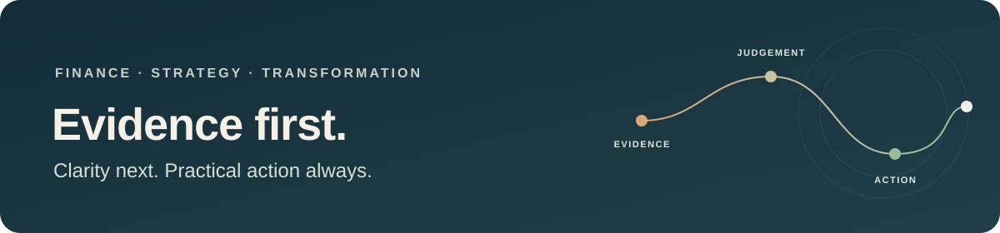

# Dima Jalbout

**Finance · Strategy · Operations · Transformation**  
Paris, France · Open to opportunities

I turn complex financial and operational questions into clear analysis and practical next steps. My experience spans ESG and decarbonisation consulting, group audit, financial analysis and client delivery across France, Lebanon and the UK.

<a href="https://dimael-jalbout-ux.github.io/">View my portfolio</a> · <a href="https://www.linkedin.com/in/dima-jalbout/">Connect on LinkedIn</a>

---

## Selected work

| Case | What it shows |
| --- | --- |
| **From climate obligations to investment choices** | Professional Terra Instinct work: climate and ESG review, risk assessment, and financial modelling for decarbonisation options. Client details and working files are omitted. |
| **Group audit across 26 subsidiaries** | Professional KPMG experience: IAS 36 impairment analysis, discounted cash flows and coordination across three continents. Confidential information is omitted. |
| [Energy investment calculator](https://dimael-jalbout-ux.github.io/energy-calculator.html) | Self-directed, illustrative business case tool for payback, net present value and return. Assumptions are visible and adjustable. |
| [Pulse support insights](https://dimael-jalbout-ux.github.io/pulse-ai.html) | Self-directed workflow prototype using fictional tickets and fixed sample labels. No live AI model, client data or production claims. |

The portfolio separates professional experience from personal demonstrations. Prototype inputs and illustrative data are labelled.

## Experience

- **Terra Instinct, London** · ESG & Transformation Consulting Intern, Mar–Aug 2026. Reviewed ESG and climate obligations, assessed risks, modelled solar, battery and heat-pump investments, and developed practical recommendations.
- **KPMG, Beirut** · Audit & Financial Advisory Intern, Sep 2025–Feb 2026. Supported group audit work across 26 subsidiaries on three continents, including IAS 36 impairment analysis and DCF modelling.
- **BFP Expertise Comptable, Toulouse** · Accounting & Financial Analysis Intern, Jan–Apr 2024. Supported seven clients during year-end close and file reviews.
- Earlier work in market analysis, investment strategy and credit analysis at Khonaysser Consulting and BLOM Bank.

## Education & leadership

- **Master in Accounting, Control & Audit**, Toulouse School of Management · Research thesis 15/20
- **MBA**, Sagesse University · Valedictorian, GPA 3.9/4.0, thesis 18/20
- **Bachelor in Finance & Accounting**, Hariri Canadian University · GPA 3.8/4.0
- Finance Club President · Elected student representative · Volleyball team captain · Red Cross team lead · Scouts leader

## Focus

Strategy and operations · Business analysis · Financial services and fintech · Consulting · AI and digital transformation · Startup operations

**Languages:** French, English and Lebanese Arabic; beginner Spanish  
**Tools:** Excel, PowerPoint, Notion, HubSpot, Salesforce and Sales Navigator

I use GitHub to make business questions, assumptions and practical demonstrations easy to inspect. My work centres on analysis, decision support and useful digital tools.

**[Portfolio](https://dimael-jalbout-ux.github.io/)** · **[LinkedIn](https://www.linkedin.com/in/dima-jalbout/)**
